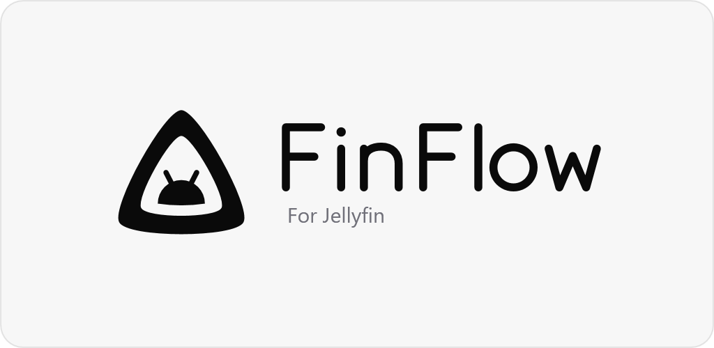

  

# FinFlow

**FinFlow** is a modified Android phone client for Jellyfin, forked from [Findroid](https://github.com/jarnedemeulemeester/findroid) by Jarne Demeulemeester.

FinFlow adds **configurable Wi-Fi / Mobile bitrate limits and live in-player transcoding bitrate switching** while preserving Findroid's clean native UI and independent client-side subtitle rendering.

---

## Key Enhancements (vs. Upstream Findroid)

- **Wi-Fi & Mobile Data Default Max Bitrate** (`Settings → Player → Streaming quality`)
  - Set independent default bitrate caps for Wi-Fi (or unmetered networks) and mobile data, from `Original` down to `1 Mbps`.
  - Automatically selects Direct Play when the media bitrate is within your cap, or requests server-side HLS transcoding when exceeded.
- **In-Player Live Bitrate Switching**
  - Switch streaming bitrate on the fly from the player top bar while preserving playback position and playback speed.
  - Properly stops previous server-side transcode sessions (`PlaybackStopped` with `playSessionId`) when switching bitrates or exiting.
- **Independent Text Subtitle Rendering During Transcoding**
  - Explicitly disables subtitle burn-in (`subtitleStreamIndex = -1`, `alwaysBurnInSubtitleWhenTranscoding = false`) and requests text subtitles (`SRT`, `ASS`, `SSA`, `VTT`, `TTML`) as external streams.
  - Keeps dual-language subtitles rendered cleanly on the client overlay so pinch-to-fill-screen zoom never crops subtitles.
- **Transcode-Mode Audio Track Switching**
  - Allows switching audio streams during active HLS transcoding by reloading the stream at the current position.
- **Independent Package ID (`io.github.jam7ee.finflow`)**
  - Installs cleanly alongside the official Findroid app.

## 简体中文简介

**FinFlow** 是基于开源 Jellyfin 安卓客户端 [Findroid](https://github.com/jarnedemeulemeester/findroid) 修改的手机端衍生版本，主要新增：

- **Wi-Fi / 移动网络分设默认最大码率**（设置 → 播放器 → 播放码率）
- **播放器内实时切换码率**（自动保留当前播放进度与倍速，并及时释放服务端转码进程）
- **转码时保留客户端独立字幕渲染**（不烧录文本字幕，双语字幕与「填满屏幕」缩放互不干扰）
- **独立包名 `io.github.jam7ee.finflow`**（可与原版 Findroid 同机共存）

## Download & Install

- Download the latest signed release APK from [GitHub Releases](https://github.com/jam7ee/FinFlow/releases):
  - `finflow-v*-libre-arm64-v8a.apk` for modern 64-bit Android phones (recommended).
  - `finflow-v*-libre-armeabi-v7a.apk` for older 32-bit ARM devices.
- Pre-release debug builds for testing are also available in [GitHub Actions](https://github.com/jam7ee/FinFlow/actions) (`phone-libre-arm64-v8a-debug.apk`).
- Requires a Jellyfin server with transcoding enabled if you select a bitrate lower than the source media bitrate.

## Credits & License

- Upstream project: [jarnedemeulemeester/findroid](https://github.com/jarnedemeulemeester/findroid) by Jarne Demeulemeester.
- This project is licensed under the **GNU General Public License v3.0 ([LICENSE](LICENSE))**, in full compliance with upstream Findroid's GPLv3 license.
